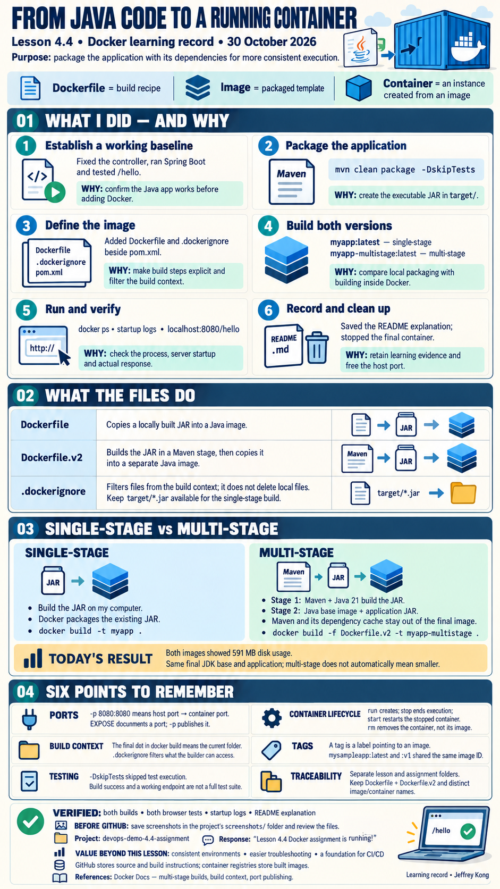

# devops-demo-4.4-assignment
## Single-stage and multi-stage builds

In my single-stage Dockerfile, the application’s JAR is built locally with Maven and then copied into a Java image. In Dockerfile.v2, the first stage uses Maven and Java 21 to compile and package the application inside Docker. The second stage copies the resulting JAR into a separate Java image and runs the application. This approach provides a consistent build environment and keeps Maven, its dependency cache, and the project source files out of the final image.

## My Docker learning record

